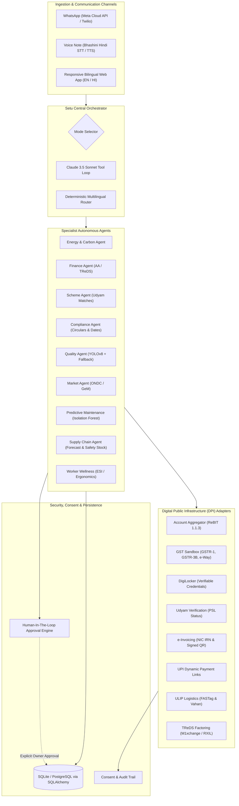

# BharatSetu AI · भारतसेतु एआई
**Agentic Digital Public Infrastructure (DPI) Copilot for MSMEs**
*Serving Auto, Engineering, and Fabrication Clusters in Indore, Pithampur, Sanwer Road, and Dewas, Madhya Pradesh.*

---

## 1. Executive Summary & Pitch
> *"Every MSME deserves a CFO, a compliance officer, and an energy auditor — in their own language, on WhatsApp."*

BharatSetu AI bridges the digital divide for 6+ crore Indian MSMEs. One central orchestrator (**Setu**) coordinates specialist autonomous agents in natural Hindi, English, and Hinglish across WhatsApp, voice, and an intuitive web application.



---

## 2. Non-Negotiable Operating Rules
1. **Human-in-the-Loop:** No agent may execute or submit a loan application, tax filing, invoice discounting, or subsidy claim without explicit owner approval through the approval engine.
2. **Honesty & Transparency:** Simulated calculations are explicitly labelled as simulated across API payloads, UI cards, and audit logs. Carbon figures are Scope 2 drafts requiring third-party verification for official EU CBAM compliance. Scheme matches are illustrative.
3. **Privacy & Consent:** Every DPI query records an immutable consent entry (purpose, scope, expiry, consent ID) in the audit ledger. Cluster observatory enforces strict $k$-anonymity ($N \ge 5$) before displaying any aggregates.
4. **Natural Language:** Natural Hindi responses in Devanagari script, not clumsy transliterations.
5. **No Hallucinated Data:** Official tariffs (MPPKVVCL), MPPCB pollution regulations, and central/state schemes are stored in verified reference data files with explicit source citations and verification dates.
6. **Zero-Downtime Offline Fallback:** Fully operational offline keyword/intent router ensures demos and shopfloor workflows never fail if internet connectivity drops.

---

## 3. Mocked vs. Real Matrix

| Capability / Rail | Current Status | Mock Implementation | Production Integration Path |
|---|---|---|---|
| **Account Aggregator (AA)** | ✅ Operational Adapter | ReBIT 1.1.3 mock generating consent handles and bank statement summaries | Connects to licensed AA (e.g., Setu, Anumati, Onemoney) via TLS mTLS client certificates |
| **GST Sandbox** | ✅ Operational Adapter | Mock returning GSTR-1, GSTR-3B filings and valid e-Way bill drafts | Direct GSTN GSP API endpoint using production GSP auth keys and OTP |
| **DigiLocker** | ✅ Operational Adapter | Mock XML document retrieval with SHA-256 digital signature simulation | MeitY DigiLocker 2.0 OAuth2 Pull URI production gateway |
| **Udyam Verification** | ✅ Operational Adapter | Verified MSME category (Small) and Priority Sector Lending eligibility | Ministry of MSME Udyam API gateway |
| **e-Invoicing** | ✅ Operational Adapter | 64-character SHA-256 IRN hash and signed QR code string generation | NIC e-Invoice system production API (v1.03) with digital signing cert |
| **UPI Payment Links** | ✅ Operational Adapter | Standard NPCI UPI URI string (`upi://pay?...`) with dynamic merchant parameters | Bank PSP API / NPCI BharatQR production webhook |
| **ULIP Logistics** | ✅ Operational Adapter | Vahan vehicle fitness + FASTag toll plaza timestamp transit tracking | National Industrial Corridor Development Corporation (NICDC) ULIP gateway |
| **TReDS Factoring** | ✅ Operational Adapter | Competitive auction simulation with real SBI/BoB clearing discount bids (8.15%) | M1xchange / RXIL Trade Receivables Discounting API |
| **Visual Quality Inspection**| ✅ **REAL AI MODEL** | **Ultralytics YOLOv8n** trained on NEU-DET surface defect dataset (`models/`) | Add industrial camera stream or edge IPC inference container |
| **Predictive Maintenance** | ✅ **REAL AI MODEL** | **Scikit-learn IsolationForest** on vibration RMS, motor current, and temperature | MQTT broker / OPC-UA IoT telemetry ingest |
| **Carbon Scope 2 Engine** | ✅ **REAL MATH & PDF**| ReportLab professional CBAM PDF draft using CEA Baseline v19 emission factors | Automated smart-meter API feed (MPPKVVCL AMR/AMI) |
| **Voice Channel** | ✅ Operational Adapter | Local intelligent ASR/TTS with natural Hindi Devanagari outputs | Live Bhashini NLTM Dhruva pipeline keys (`BHASHINI_API_KEY`) |
| **WhatsApp Channel** | ✅ Operational Adapter | Dual-compatible parser for Meta Cloud API JSON and Twilio form data | Meta WhatsApp Business Cloud API webhook verification |

---

## 4. Quick Start & Setup

### Prerequisites
- Python 3.11, 3.12, or 3.13
- Git

### Installation
```bash
# 1. Clone or navigate into the repository
cd c:\Users\prudh\Downloads\bharatsetu-ai

# 2. Create virtual environment and activate
python -m venv .venv
# Windows:
.venv\Scripts\activate
# Linux/macOS:
# source .venv/bin/activate

# 3. Install dependencies
pip install -r requirements.txt

# 4. Configure environment variables (optional for offline mode)
cp .env.example .env

# 5. Seed the database with demo profile & cluster cohorts
python -m backend.seed

# 6. Run the FastAPI application
uvicorn backend.main:app --reload --port 8000
```
Open **http://127.0.0.1:8000** in your browser.

---

## 5. Docker Deployment

Start the application with one command:
```bash
docker compose up --build
```
The application will bind to `http://localhost:8000` with automated healthchecks.

---

## 6. Running Tests

Run the comprehensive automated pytest suite (38 tests covering all agents, auth, approval flow, DPI adapters, and browser E2E flows):
```bash
# Run full pytest suite
pytest -v

# Run Playwright end-to-end browser tests
pytest -v tests/test_browser_e2e.py
```

---

## 7. Configuration (.env)

| Variable | Default Value | Description |
|---|---|---|
| `ANTHROPIC_API_KEY` | *(empty)* | Optional. When present, enables Claude 3.5 Sonnet tool-use orchestrator loop. When absent, falls back to offline router. |
| `BHARATSETU_MODEL` | `claude-sonnet-5-5` | Anthropic model identifier. |
| `DATABASE_URL` | `sqlite:///./bharatsetu.db` | SQLAlchemy database URI (SQLite for local, PostgreSQL for cloud). |
| `DEMO_MODE` | `false` | When `true`, enables shared demo tenant and simulated offline testing. |
| `JWT_SECRET` | *(unset)* | Minimum 32-character secret for signing user tokens (required in production). |
| `SEED_OWNER_PASSWORD` | *(unset)* | Custom password for seeded owner; generated randomly if unset. |
| `DPI_MODE` | `mock` | `mock` for sandboxed offline testing; `real` to route to production DPI gateways. |
| `MAX_UPLOAD_BYTES` | `8388608` | Hard upload cap (8 MB) for part images and CSV files. |
| `RATE_LIMIT_PER_MINUTE` | `60` | In-memory token-bucket rate limiter per IP address. |
| `WHATSAPP_VERIFY_TOKEN` | *(unset)* | Verification handshake secret for Meta WhatsApp Cloud API. |
| `BHASHINI_API_KEY` | *(empty)* | Optional MeitY Bhashini API key for live speech-to-text. |

---

## 8. Demo Credentials & Workflows
- **Demo Owner Login:** In `DEMO_MODE=true`, seeded with username `owner` (password configured via `SEED_OWNER_PASSWORD` or printed to terminal during seed).
- **Main Web Copilot:** `http://localhost:8000/`
- **Owner Operations Dashboard:** `http://localhost:8000/dashboard`
- **District Cluster Observatory:** `http://localhost:8000/cluster`
